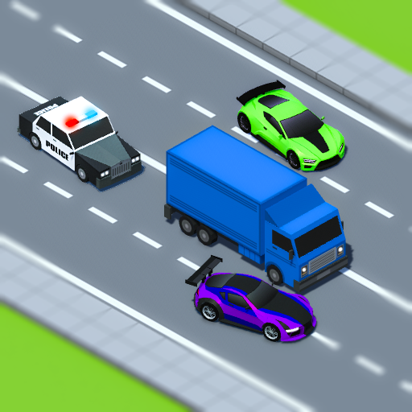

# Turbo Traffic



An arcade endless-driving game built with Unity for Yandex Games. Drive through dense traffic, overtake rivals, collect gems, and earn money to unlock and customize cars.

## 📦 Features

- Arcade car controls with acceleration, braking, steering, collision handling, and visual effects.
- Endless road generation with dynamically spawned traffic and oncoming vehicles.
- Scoring based on speed, distance, overtaking, and driving in the oncoming lane.
- Collectible gems, animated VFX, and rewards at the end of a run.
- Garage with car selection, purchases, color variants, vehicle stats, and upgrades.
- Persistent money, selected car, colors, high score, graphics settings, and audio settings through Yandex Games saves.
- Continue flow, pause menu, finish screen, sound effects, localization, and Yandex Games leaderboard support.
- Object pooling for traffic and gem spawning, plus URP quality presets for performance tuning.

## 📋 Requirements

Unity `2022.3.34f1`.

## 🚀 Build and run

```bash
git clone https://github.com/MrDoodeth/turbo-traffic.git
cd turbo-traffic
```

Open the project folder in Unity Hub with Unity `2022.3.34f1`.

The build settings include these scenes:

- `Assets/_Scenes/Garage.unity`
- `Assets/_Scenes/Race.unity`

To play in the editor, open a scene and press **Play**. To build a WebGL version, open **File → Build Settings**, select **WebGL**, make sure both scenes are included, then choose **Build** or **Build And Run**.

## 🗂️ Project layout

```text
turbo-traffic/
├── Assets/
│   ├── _RaceRunner/     # Gameplay scripts, prefabs, UI, and VFX
│   ├── _Scenes/         # Garage and Race scenes
│   ├── _Settings/       # URP and lighting configuration
│   └── WebGLTemplates/  # Yandex Games WebGL template
├── Packages/            # Unity package manifest and lock file
└── ProjectSettings/     # Unity project and build settings
```

## 📜 License

MIT, see [LICENSE](LICENSE).
